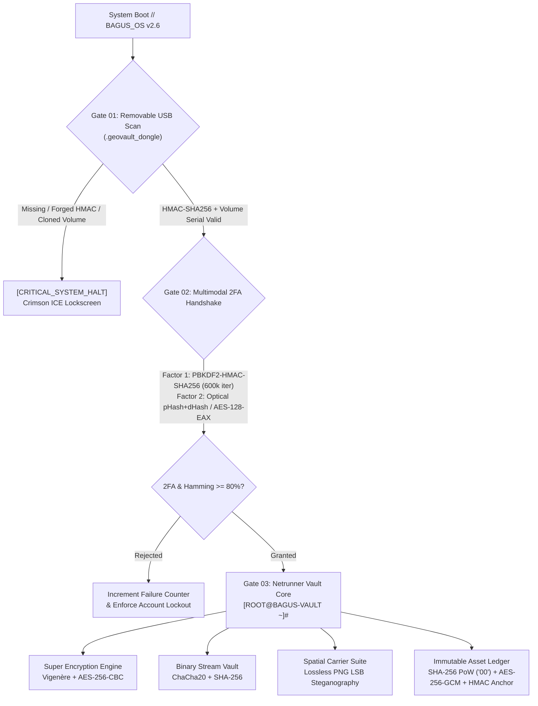

# ⚡ B.A.G.U.S. (Biometric-Authenticated Gatekeeper & Unified Security) Vault  // TERMINAL v2.6 — GeoVault Spatial & Secret Document Digital Vault

```text
 ██████╗  █████╗  ██████╗ ██╗   ██╗███████╗      ██████╗ ███████╗    ██╗   ██╗██████╗    ██████╗ 
 ██╔══██╗██╔══██╗██╔════╝ ██║   ██║██╔════╝     ██╔═══██╗██╔════╝    ██║   ██║╚════██╗  ██╔════╝ 
 ██████╔╝███████║██║  ███║██║   ██║███████╗     ██║   ██║███████╗    ██║   ██║ █████╔╝  ███████╗ 
 ██╔══██╗██╔══██║██║   ██║██║   ██║╚════██║     ██║   ██║╚════██║    ╚██╗ ██╔╝██╔═══╝   ██╔═══██╗
 ██████╔╝██║  ██║╚██████╔╝╚██████╔╝███████║███████╗██████╔╝███████║     ╚████╔╝ ███████╗██╗╚██████╔╝
 ╚═════╝ ╚═╝  ╚═╝ ╚═════╝  ╚═════╝ ╚══════╝╚══════╝╚═════╝ ╚══════╝      ╚═══╝  ╚══════╝╚═╝ ╚═════╝ 
```

**GeoVault (`BAGUS_OS // TERMINAL v2.6 — AegisNet Subsystem`)** is a defense-in-depth digital vault engineered in Python and Streamlit for securing classified geospatial intelligence, cryptographic certificates, and sensitive binary documents. Presented through a high-contrast Cyberdeck Command Line Interface (`[ROOT@BAGUS-VAULT ~]#`) with real-time execution telemetry, the system enforces physical hardware-token gating, multimodal biometric-cryptographic authentication, and Proof-of-Work ledger auditing.

---

## 🏛️ Architectural Philosophy

GeoVault is designed around three core security principles:

1. **Zero-Plaintext Persistence**: No raw passwords, unencrypted biometric vectors, plaintext spatial notes, or unsealed document streams are ever written to SQLite or the local filesystem.
2. **Domain-Separated Key Hierarchy**: A 256-bit CSPRNG master secret feeds an **HKDF-SHA256** key derivation tree (`GeoVault/v1/key-hierarchy`), isolating cryptographic keys across subsystems (`dongle/hmac-sha256`, `auth/password-pepper`, `ledger/aes-256-gcm`, `ledger/anchor-hmac`).
3. **Sequential Gatekeeper Enforcement**: Every session reruns through a strict three-stage state machine. Removing the hardware USB token immediately revokes active operator state and drops the interface back to the containment lockscreen.

---

## 🔐 Security Pipeline & Cryptographic Flowchart



---

## 🛡️ Core Cryptographic Specifications

### 1. Hardware Dongle Authentication (`HMAC-SHA256` USB Token)
- Enumerates mounted removable volumes via `psutil` (plus configurable local fallback paths) for a hidden `.geovault_dongle` token.
- Computes a canonical JSON digest signed with **HMAC-SHA256** using the `dongle/hmac-sha256` sub-key and verifies it in constant time (`HMAC.hexverify`).
- Binds tokens to the physical Windows volume serial number (`GetVolumeInformationW`) to prevent bit-for-bit token cloning across flash drives.

### 2. Biometric Optical Scanner + Salted `SHA-256` & `AES-128-EAX` Login
- **Knowledge Factor**: Passwords are salted with 16 CSPRNG bytes and stretched through **PBKDF2-HMAC-SHA256** ($600{,}000$ iterations), then combined with a server-side pepper via **HKDF-SHA256** to derive two cryptographically independent outputs: a 256-bit `auth/verifier` and a 128-bit `auth/biometric-key`.
- **Inherence Factor**: Captures live optical frames via `st.camera_input` (or high-resolution fallback images), decodes via `PIL.Image`, normalizes to a fixed `128x128` 8-bit grayscale matrix with histogram equalization, and computes a `hashlib.sha256` cryptographic pixel digest alongside a 128-bit structural/gradient perceptual vector (`64-bit block hash || 64-bit dHash`).
- **Template Protection**: Biometric templates are sealed with **AES-128-EAX** authenticated encryption using `auth/biometric-key` (never stored in the database) and bound to the operator username via Associated Data (AAD). Authentication requires constant-time verifier matching and a normalized Hamming similarity $\ge 80\%$.

### 3. Super Encryption Engine (`Vigenère Cipher` + `AES-256-CBC`)
- **Layer 1 (Classical Polyalphabetic Substitution)**: Applies an extended Vigenère transformation across the UTF-8 byte stream:
  $$C_i = (P_i + K_{i \bmod |K|}) \bmod 256$$
- **Layer 2 (Modern Block Cipher)**: Pads the intermediate stream with PKCS#7 and encrypts it under **AES-256-CBC** using a fresh 16-byte random IV and a 256-bit key derived via PBKDF2-HMAC-SHA256.

### 4. File Protection Suite (`ChaCha20` Stream Cipher)
- Encrypts arbitrary binary documents (PDF, GeoJSON, KML, archives, DOCX) using a 256-bit **ChaCha20** stream cipher key derived from the operator passphrase and a 16-byte random salt.
- Computes the original document's `SHA-256` plaintext digest prior to encryption and verifies it immediately after decryption to detect bit-flips or wrong passphrases.

### 5. Field-Level Database Encryption (Encrypted SQLite at Rest)
- Uses parameterized SQLite queries with strict `BEGIN IMMEDIATE` write transactions in `storage/geovault.db`.
- Every sensitive column is encrypted or hashed before reaching the persistence layer:
  - `users.password_hash`: PBKDF2-HMAC-SHA256 $\to$ HKDF verifier
  - `users.bio_template`: `nonce(16B) || tag(16B) || AES-128-EAX(template)`
  - `secret_messages.ciphertext`: Vigenère + AES-256-CBC token
  - `encrypted_files`: ChaCha20 salt, nonce, and plaintext SHA-256 (ciphertext blobs stored under `storage/files/<random_hex>.enc`)
  - `blockchain_ledger.encrypted_asset_metadata`: Base64 `nonce(12B) || tag(16B) || AES-256-GCM(metadata)`

### 6. LSB (Least Significant Bit) Image Steganography
- Embeds classified text and coordinate payloads into the least significant bit-plane of 24-bit/32-bit lossless **PNG** cover images:
  $$C'_{c} = (C_{c} \mathbin{\&} \text{0xFE}) \mathbin{|} b_k, \quad c \in \{R, G, B\}$$
- Enforces lossless PNG output so DCT compression artifacts never corrupt embedded payload bits.

### 7. Verifiable Blockchain Ledger with Proof-of-Work Integrity Checking
- Critical assets (*Secret Coordinates*, *Digital Certificates*, *High-Value Records*) are encrypted with **AES-256-GCM** (with `index` and `asset_name` bound as AAD) and committed to an append-only chain.
- Each block mines a `nonce` until `SHA-256(canonical_header)` satisfies the Proof-of-Work difficulty prefix `"00"`.
- Stores an **HMAC-SHA256 tip anchor** in `app_meta` (`HMAC(K_anchor, last_index || last_hash)`), preventing an attacker with raw SQLite access from modifying a historical block and re-mining subsequent blocks undetected.

---

## 📂 Repository Structure

```text
geovault-crypto-app/
├── app.py                   # Main Streamlit application & 3-stage security gatekeeper
├── ui_cyberpunk.py          # BAGUS_OS // TERMINAL v2.6 CSS, CRT overlay & CLI telemetry console
├── config.py                # HKDF-SHA256 key hierarchy & filesystem path configuration
├── database.py              # SQLite schema initialization & parameterized CRUD transactions
├── generate_dongle.py       # CLI & Streamlit utility to provision/verify .geovault_dongle tokens
├── modules/
│   ├── __init__.py
│   ├── dongle_guard.py      # USB volume scanner, HMAC-SHA256 token signer & volume serial lock
│   ├── auth_biometric.py    # PBKDF2-SHA256 KDF, PIL 128x128 SHA-256 template & AES-128-EAX cipher
│   ├── blockchain.py        # SHA-256 PoW ledger, AES-256-GCM metadata & tamper auditor
│   ├── super_encryption.py  # Cascade Vigenère + AES-256-CBC text encryption engine
│   ├── file_crypto.py       # ChaCha20 binary stream encryption & SHA-256 integrity verifier
│   └── steganography.py     # Lossless PNG Least Significant Bit (LSB) carrier module
├── storage/
│   └── .gitkeep             # Runtime directory for geovault.db & encrypted file blobs
├── requirements.txt         # Python package dependencies
└── README.md
```

---

## ⚙️ Prerequisites & Dependencies

- **Python**: `3.10+` (tested on Python `3.13`)
- **Packages** (`requirements.txt`):
  - `streamlit>=1.38.0`
  - `pycryptodome>=3.20.0`
  - `pillow>=10.0.0`
  - `psutil>=5.9.0`

---

## 🚀 Quick Start & Installation Guide

### 1. Clone & Install Dependencies
```powershell
cd geovault-crypto-app
pip install -r requirements.txt
```

### 2. Launch the Terminal Interface
```powershell
streamlit run app.py
```
On first launch, **BAGUS_OS // TERMINAL v2.6** boots into `[CRITICAL_SYSTEM_HALT: HARDWARE_DONGLE_NOT_FOUND]` (Gate 01 Lockdown) until a valid `.geovault_dongle` hardware token is detected.

### 3. Provision a Hardware USB Dongle (or Local Virtual USB)
Open a second terminal inside `geovault-crypto-app` and provision either a physical flash drive or the local testing directory:

- **Option A — Physical Removable USB Drive (e.g., `E:\` on Windows):**
  ```powershell
  # List detected removable USB drives and their volume serial numbers:
  python generate_dongle.py --list

  # Sign and write a hidden .geovault_dongle token bound to drive E:\:
  python generate_dongle.py --target E:\ --label "AEGIS_OP_KEY_01" --overwrite
  ```

- **Option B — Local Virtual USB Directory (`./virtual_usb` for testing without hardware):**
  ```powershell
  python generate_dongle.py --local --overwrite
  ```

- **Option C — Interactive Dongle Provisioning Studio (Streamlit UI):**
  ```powershell
  streamlit run generate_dongle.py --server.port 8502
  ```

Return to the main application (`http://localhost:8501`) and click **⚡ RESCAN_USB_BUS // VALIDATE HMAC-SHA256 DONGLE** to clear Gate 01.

---

## 🧪 Usage & Live Verification Guide

### 1. Enrolling & Authenticating with 2FA Biometrics (Gate 02)
1. Open the **`📝 [02] ENROLL_NEW_IDENTITY`** tab, specify an operator handle and passkey, and capture a facial frame via webcam (or upload a portrait/fingerprint image).
2. Switch to **`🔑 [01] AUTHENTICATE_OPERATOR`**, supply the same credentials and biometric scan, and click **`🔓 EXECUTE_2FA_HANDSHAKE // UNLOCK VAULT`**.
3. Inspect the `[ROOT@BAGUS-VAULT ~]#` console at the bottom of the screen to observe the real-time `PBKDF2-SHA256` and `AES-128-EAX` execution logs and `0x...` SHA-256 digests.

### 2. Auditing SQLite Encryption at Rest
To verify that no plaintext credentials, biometric templates, or asset payloads exist on disk, inspect `storage/geovault.db` directly:
```powershell
python -c "import sqlite3; c=sqlite3.connect('storage/geovault.db'); print('USERS:', c.execute('SELECT username, substr(password_hash,1,24), hex(substr(bio_template,1,24)) FROM users').fetchall()); print('LEDGER:', c.execute('SELECT block_index, asset_name, substr(encrypted_asset_metadata,1,36), current_hash FROM blockchain_ledger').fetchall())"
```

### 3. Testing Blockchain Proof-of-Work & Tamper Detection
1. Navigate to **`⛓️ [01] POW_BLOCKCHAIN_LEDGER`** in the sidebar and mine a new critical asset block under **`⛏️ [01] MINE_NEW_ASSET_BLOCK`**.
2. Click **`🔍 VERIFY_BLOCKCHAIN_INTEGRITY // FULL HASH AUDIT`** to confirm that all blocks satisfy the `"00"` PoW target, hash links, AES-256-GCM authentication tags, and HMAC chain-tip anchor.
3. Open **`🧪 [03] TAMPER_SIMULATION_LAB`**, select any block, choose an attack vector (*Direct SQLite Edit*, *Smart Attacker Chain Re-Mine*, or *Block Deletion*), and click **`💥 INJECT_SQLITE_TAMPER_PAYLOAD`**.
4. Observe the immediate `[CRITICAL_LEDGER_TAMPER_DETECTED]` alert identifying the exact compromised block index and cryptographic failure mode (`HASH_MISMATCH`, `BROKEN_LINK`, `DECRYPTION_FAILED`, or `ANCHOR_MISMATCH`).

---

## 👥 Engineering Team

| Contributor | Role |
| :--- | :--- |
| **Core Cryptography & Security Engineering Team** | Cryptographic Architecture, Key Hierarchy, Biometric & Hardware Authentication, PoW Ledger, Stream/Block Cipher Engines, Steganography & Cyberdeck CLI Interface |
